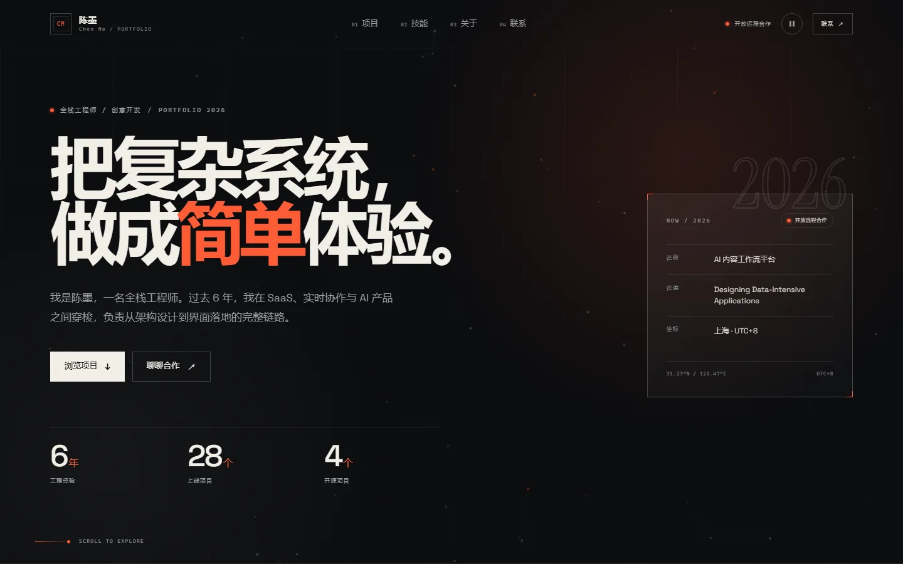

# 陈墨 · 个人作品集

纯静态、免登录、免构建的 Web 版个人作品集。深色编辑风格，使用 **Vue 3 + vue3-sfc-loader + GSAP + Lenis + 原生 Canvas**，源码目录即部署产物。



## 快速开始

项目没有构建步骤，但 `.vue` 文件需要由 HTTP 服务加载（不能用 `file://` 直接打开）：

```bash
# 任选一种
python3 -m http.server 8000
# 或
npx serve .
```

浏览器访问 <http://localhost:8000>。修改 `.vue`、`.js`、`.css` 或 `data/` 下的内容后刷新即可生效。

> 不要直接双击 `index.html`。`file://` 协议下浏览器会拦截 `fetch` 加载 `.vue` 文件。

## 目录结构

```text
index.html              # 入口：import map、GSAP、loader bootstrap、加载骨架
app.vue                 # 根组件：导航、页面、动效开关
pages/home.vue          # 单页编排：Lenis、滚动高亮、锚点、各章节
components/
  SiteHeader.vue        # 固定导航 + 移动端 dialog 菜单 + 动效开关
  HeroSection.vue       # 首屏
  HeroParticles.vue     # Canvas 粒子（鼠标排斥 / 降级 / 暂停）
  ProjectsSection.vue   # 项目卡片 + 原生 dialog 详情
  SkillsSection.vue     # 技能网格
  AboutSection.vue      # 简介、原则、经历时间线
  ContactSection.vue    # 邮箱复制、社交链接、页脚
  SectionHeading.vue    # 章节标题
data/
  site.js               # 个人资料、导航、技能、经历、社交链接
  projects.js           # 项目数据（唯一项目内容源）
styles/main.css         # 设计 token、布局、响应式、reduced-motion
runtime/lenis.js        # Lenis 的 CDN 优先 / 本地兜底适配器
assets/                 # 字体、favicon、6 张项目概念 SVG
vendor/                 # 固定版本依赖的离线兜底副本
preview/                # 桌面 / 移动端预览图
```

## 内容维护

### 个人资料与站点文案

编辑 `data/site.js`：

- `profile`：姓名、身份、邮箱、地点、可用状态、首屏统计与 now 卡片
- `nav`：导航锚点
- `skills`：四组技能
- `about`：关于段落与三条工作原则
- `experience`：工作 / 教育时间线
- `marqueeItems`：首屏下方滚动文字

### 项目

编辑 `data/projects.js`。字段含义：

| 字段 | 说明 |
| --- | --- |
| `id` | 唯一标识，用于卡片 key |
| `index` / `year` | 卡片左上与右上角元信息 |
| `title` / `subtitle` | 项目名与一句话简介 |
| `role` / `team` | 详情弹窗中的角色与团队规模 |
| `stack` | 技术栈，卡片与详情都会展示 |
| `tags` | 2–3 个短标签 |
| `image` | 项目视觉，建议 3:2；放在 `assets/projects/` |
| `problem` / `solution` | 卡片与详情中的问题 / 方案 |
| `impact` | 结果列表 |
| `detail.context` | 项目背景 |
| `detail.bullets` | 关键动作 |
| `detail.learning` | 复盘金句 |

新增项目只需复制一个对象、改字段、放入图片，刷新即可。项目卡片与弹窗都由数据驱动，不需要改组件。

当前项目视觉是 6 张本地 SVG 概念图。替换为真实截图时保持 3:2 比例，并把 `` 的 `alt` 改为更具体的描述即可（当前模板使用 `标题 + 项目概念视觉`）。

### 替换视觉与字体

- 项目图：`assets/projects/*.svg`
- 字体：`assets/fonts/space-grotesk-latin-wght-normal.woff2`（可变字重）与 `instrument-serif-latin-400-normal.woff2`
- 主题色、间距、断点：`styles/main.css` 顶部的 `:root` 设计 token

## 技术说明

### 为什么数据通过 `provide/inject` 注入？

`vue3-sfc-loader@0.9.5` 会把组件内 `import '../data/site.js'` 当作**普通脚本**解析，遇到 ESM 的 `export` 会报 `sourceType: module` 错误。因此入口 `index.html` 用原生 `import()` 加载 `data/*.js`，再通过 `app.provide('site' / 'projects')` 注入组件。

组件仍然使用 `<script setup>`；只是数据 import 不放进 `.vue` 内。维护时请保持这个约定，否则会重新触发 loader 的脚本解析问题。

### 依赖与兜底

| 依赖 | 版本 | 加载方式 |
| --- | --- | --- |
| Vue 3 | 3.5.13 | import map（`vue.esm-browser.prod.js`） |
| vue3-sfc-loader | 0.9.5 | import map（ESM） |
| GSAP + ScrollTrigger + SplitText | 3.13.0 | `<script>` 标签 + 手动 `registerPlugin` |
| Lenis | 1.3.11 | import map → `runtime/lenis.js`（CDN 优先，本地兜底） |
| 字体 | 自托管 | `@font-face` + woff2 |

所有 CDN 链接都写死完整版本号。`vendor/` 中保留同版本副本：

- Vue / loader / GSAP 在 CDN 不可用时由 bootstrap 自动切换本地副本
- Lenis 由 `runtime/lenis.js` 优先请求 CDN（2.5s 超时），失败后加载 `vendor/lenis.mjs`
- 字体与项目图完全本地，不依赖外部图床

这样即使 CDN 暂时不可用，页面内容、导航、弹窗与字体仍可完整使用；首次加载会显示加载骨架。

### 动效与可访问性

- 所有 GSAP 入场、ScrollTrigger、Canvas 粒子、Lenis 都会检查 `prefers-reduced-motion: reduce`；开启后跳过动画、不启动粒子循环、不初始化 Lenis、暂停 marquee
- 导航栏右上角的暂停按钮可暂停粒子与 marquee，状态通过 `aria-pressed` 暴露
- 项目详情与移动端菜单使用原生 `<dialog>`，带焦点陷阱、Esc 关闭、关闭后焦点回到触发按钮
- 首屏提供跳过导航链接；`main` 可聚焦；Tab 顺序与 `:focus-visible` 样式完整
- Canvas `aria-hidden="true"`；章节使用 `section` + `aria-labelledby`；图片懒加载
- 粒子数量：桌面 64，移动端 30；DPR 上限 2；页面不可见或离开视口时暂停
- 只对 `opacity` / `transform` 做动画，不做 `width/height/top/left` 动画

## 已验证

在 Edge headless（本地 HTTP + 本地依赖映射）下完成：

- 首屏 FCP 约 **196ms**，应用挂载完成约 **1.15s**（桌面 1440×900）
- 320 / 375 / 768 / 1024 / 1440px 均无横向滚动
- 6 张项目图全部加载，无 404 / 失败请求
- axe-core 4.10.2：桌面与移动端 **0 violations**
- 暂停按钮、复制邮箱、项目弹窗焦点陷阱、Esc 关闭、移动端菜单、锚点导航与滚动高亮均通过
- 关闭网络（模拟 CDN 不可用）后仍能完整加载，Lenis 走本地兜底
- 图片懒加载、字体自托管、`prefers-reduced-motion` 全站降级均正常

上线前建议再用 Lighthouse 移动端复测性能分数；本项目未在自动化流程中运行 Lighthouse。

## 分享给别人

`http://localhost:8000/` **不能**发给别人：`localhost` 永远指访问者自己的电脑。要让别人看到，必须把站点放到公网，或用同一局域网 / 临时隧道。

项目已经生成好部署包：`portfolio-site.zip`（约 686 KB，`index.html` 在压缩包根目录，包含运行所需的全部文件，不含文档与预览图）。

### 方式 A：Netlify Drop（最快，推荐）

1. 打开 <https://app.netlify.com/drop>
2. 把 `portfolio-site.zip` 直接拖进页面（或拖整个项目文件夹）
3. 等待 10–30 秒，得到 `https://xxx.netlify.app`
4. 用无痕窗口或手机流量打开验证

不需要登录也可以先拿到临时链接；要长期保留或绑定自定义域名时再注册并 claim 站点。

### 方式 B：GitHub Pages（免费长期）

1. 新建一个 GitHub 仓库（public）
2. 把 `portfolio-site.zip` 解压后的内容上传到仓库根目录，确保 `index.html` 在根目录
3. Settings → Pages → Source: Deploy from a branch → main / (root)
4. 等待 1–2 分钟，访问 `https://<用户名>.github.io/<仓库名>/`

仓库里要包含 `.nojekyll`（本包已带），否则 GitHub Pages 的 Jekyll 可能忽略部分文件。子路径部署已经验证，资源全部使用相对路径。

### 方式 C：Vercel / Cloudflare Pages

- **Vercel**：导入 Git 仓库，Framework Preset 选 Other，Build Command 留空，Output Directory 填 `.`
- **Cloudflare Pages**：连接仓库，Build command 留空，Build output directory 填 `/`
- 也可以在项目目录执行 `npx vercel` 部署

### 方式 D：临时给同一 Wi‑Fi 的人看

不需要部署，但只能在同一个局域网：

```bash
python -m http.server 8000 --bind 0.0.0.0
```

然后查本机局域网 IP（Windows 用 `ipconfig`，看 IPv4 地址），别人访问 `http://192.168.x.x:8000/`。Windows 防火墙弹出时选择允许。电脑不能关机或睡眠，服务也不能停。

### 方式 E：临时公网隧道

不想部署、但需要马上发给外网的人：

```bash
# Cloudflare Tunnel（需先安装 cloudflared）
cloudflared tunnel --url http://localhost:8000

# 或 ngrok
ngrok http 8000
```

会得到一个临时公网 URL。缺点是电脑必须一直开着，关掉隧道就失效，适合演示，不适合长期简历投递。

### 部署前检查

- 用无痕窗口打开公网 URL，确认首页、项目弹窗、联系链接正常
- 用手机流量打开一次，避免只验证了同 Wi‑Fi 缓存
- Network 面板确认无 404；`data/*.js`、`.vue`、`vendor/` 均可访问
- 把示例邮箱 `hello@chenmo.dev` 换成你的真实邮箱
- 如果访客网络访问不了 jsDelivr，页面会自动使用 `vendor/` 本地副本，不需要额外配置

## 部署参数

- **Build command**：留空
- **Output directory**：项目根目录
- **Node.js**：不需要
- 不要引入 `package.json`、`node_modules/` 或构建配置
- 静态托管必须通过 HTTP(S) 访问，不能使用 `file://`

## 备注

当前姓名、项目、经历与社交链接均为**示例内容**，用于展示版式与交互。把它们替换成你的真实信息即可；所有文案都集中在 `data/site.js` 与 `data/projects.js`，不需要翻组件。
